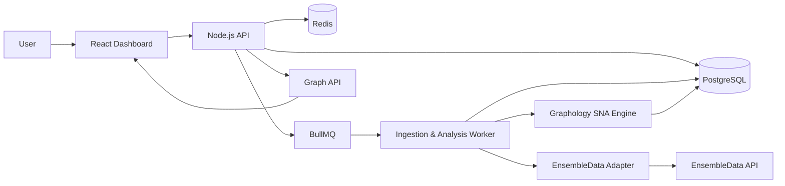

# Architecture & Technical Design

## 1. Tujuan
Membangun aplikasi lokal berbentuk satu dashboard untuk mengumpulkan data sosial media berbasis target/trending, menyimpan data lintas platform dalam skema seragam, dan menganalisis relasi sosial menggunakan SNA.

## 2. Logical architecture



## 3. Component responsibilities
### Frontend
- React + Vite + TypeScript.
- Dashboard shell dengan navigasi: Overview, Collection, Accounts, Posts, Trends, Network Graph, Analysis Runs, Settings.
- Cytoscape.js untuk node-edge rendering, layout, pan/zoom, selection, styling, animation, neighborhood expansion.
- Filter: platform, project, tanggal, tipe edge, minimum weight, komunitas, metric.
- Graph renderer hanya menerima data graph terstruktur dari API; jangan mengirim seluruh raw payload ke browser.

### API
- Express + TypeScript.
- Validasi request dengan Zod.
- Auth lokal dan RBAC disiapkan untuk fase berikutnya.
- REST API untuk project, collection job, data explorer, graph, analysis, export.
- API key provider hanya digunakan server-side.

### Worker
- BullMQ worker memproses collection job dan analysis job.
- Retry eksponensial, concurrency terbatas, idempotency key, status job, dan dead-letter handling.
- Simpan raw response sebelum/bersamaan dengan normalisasi untuk audit dan debugging.

### Provider adapter
Interface internal yang disarankan:
```ts
interface SocialDataProvider {
  searchPosts(input: SearchPostsInput): Promise<ProviderPage<RawPost>>;
  getUserProfile(input: UserProfileInput): Promise<RawProfile>;
  getUserPosts(input: UserPostsInput): Promise<ProviderPage<RawPost>>;
  getPostComments(input: PostCommentsInput): Promise<ProviderPage<RawComment>>;
  getTrending?(input: TrendingInput): Promise<ProviderPage<RawTrend>>;
}
```
Semua operasi bersifat opsional sesuai kapabilitas provider. Adapter menerjemahkan respons vendor ke DTO internal; normalizer memetakan DTO ke tabel kanonis.

**EnsembleData:** verifikasi endpoint, method HTTP, token placement, pagination, parameter platform, response envelope, quota/cost, dan ketersediaan endpoint terhadap dokumentasi resmi akun yang dipakai. Jangan mengasumsikan seluruh platform memiliki endpoint/field yang sama. `client.ts` pada starter hanyalah placeholder konfigurasi HTTP, bukan klaim endpoint final.

## 4. Canonical graph model
### Node types
- `account`: akun/kanal publik.
- `post`: postingan.
- `hashtag`: hashtag.
- `keyword`: keyword/topic (opsional).
- `media`: entitas media (opsional).

### Edge types
- `FOLLOWS`: account -> account (hanya bila data relasi tersedia).
- `AUTHORED`: account -> post.
- `REPLIED_TO`: account -> post/account, sesuai konteks komentar.
- `COMMENTED_ON`: account -> post.
- `MENTIONED`: post/account -> account.
- `HAS_TAG`: post -> hashtag.
- `RESHARED`: account -> post/account (platform dependent).
- `INTERACTED_WITH`: relasi agregat yang harus diberi definisi dan provenance.

Edge harus menyimpan `source_platform`, `source_record_id`, `observed_at`, `weight`, `directed`, dan `relationship_type`. Jangan gabungkan tipe hubungan yang berbeda tanpa opsi filter.

## 5. SNA metrics
Metrik dipilih per analysis run:
- Degree centrality: jumlah/proporsi koneksi masuk dan keluar.
- Betweenness centrality: peran node pada jalur terpendek; mahal untuk graf besar, sediakan sampling/limit.
- Closeness centrality: kedekatan terhadap node lain; perhatikan disconnected components.
- Eigenvector centrality: pengaruh berdasarkan koneksi ke node penting.
- PageRank: skor berbasis tautan terarah dan damping factor.
- Density: kepadatan keseluruhan graf (metrik tingkat graf).
- Community detection: kelompok node; simpan algorithm, parameter, dan modularity score bila algoritma mendukung.

Setiap metrik harus menyimpan versi algoritma, parameter, directed/weighted mode, graph snapshot, timestamp, serta status. Jangan membandingkan skor dari snapshot/parameter berbeda tanpa penjelasan.

## 6. Database recommendation
PostgreSQL + Prisma direkomendasikan untuk MVP karena:
- transaksi dan integritas referensial untuk ingestion;
- JSONB untuk field provider yang bervariasi;
- indexing dan SQL analytics;
- satu database lebih mudah dioperasikan lokal.

Tabel inti ada di `prisma/schema.prisma`. Untuk volume besar, tambahkan partitioning pada `posts`, `comments`, `account_relationships`, dan `graph_edges` berdasarkan waktu atau workspace. Tambahkan GIN index untuk JSONB hanya pada field yang sering dicari.

Neo4j bukan dependensi wajib MVP. Evaluasi jika kebutuhan traversal multi-hop interaktif menjadi dominan atau query graf mulai membebani PostgreSQL.

## 7. REST API proposal
| Method | Path | Fungsi |
|---|---|---|
| GET | `/health` | Health check |
| POST | `/api/v1/projects` | Buat project |
| GET | `/api/v1/projects` | Daftar project |
| POST | `/api/v1/collections` | Buat job pengumpulan |
| GET | `/api/v1/collections/:id` | Status job |
| GET | `/api/v1/accounts` | Cari/daftar akun |
| GET | `/api/v1/posts` | Cari/daftar postingan |
| GET | `/api/v1/trends` | Daftar trending yang terkumpul |
| POST | `/api/v1/analysis-runs` | Jalankan analisis SNA |
| GET | `/api/v1/analysis-runs/:id` | Status/hasil analisis |
| GET | `/api/v1/graphs/:snapshotId` | Graph nodes + edges |
| GET | `/api/v1/metrics` | Daftar metrik tersedia |
| GET | `/api/v1/exports/:id` | Unduh hasil ekspor |

## 8. Collection workflow
1. User memilih project, platform, mode (`target` atau `trending`), query/username/hashtag, rentang tanggal, batas jumlah, dan jenis data.
2. API memvalidasi input dan membuat `collection_job`.
3. API memasukkan job ke BullMQ.
4. Worker memanggil provider adapter dengan rate limit dan pagination.
5. Raw response disimpan secara terbatas; normalizer melakukan upsert akun/post/comment/tag.
6. Resolver membangun relasi kanonis dengan provenance.
7. Job ditandai selesai/gagal/parsial dan metrik biaya/kuota dicatat bila provider menyediakan.
8. User dapat membuat graph snapshot dan menjalankan analisis.

## 9. Graph UX
- Default graph dimulai dari satu target atau satu post dan depth terbatas.
- Node size dapat dipetakan ke metric yang dipilih.
- Node color berdasarkan tipe node atau community.
- Edge width berdasarkan weight; edge style berdasarkan relationship type.
- Klik node membuka detail akun/post dan panel metric.
- Toggle directed/undirected, weighted/unweighted, hide isolates, filter date/platform.
- Animasi hanya untuk orientasi/penelusuran; sediakan tombol pause/reduced motion.
- Hindari menampilkan ribuan node sekaligus; gunakan limit, clustering, pagination, neighborhood expansion.

## 10. Local Docker services
- `web`: frontend static build + Nginx.
- `api`: Express API.
- `worker`: BullMQ worker (entrypoint disiapkan untuk implementasi).
- `db`: PostgreSQL.
- `redis`: Redis.

## 11. Deployment and operations
- `docker compose up --build -d` untuk development lokal.
- Volume persisten untuk PostgreSQL dan Redis.
- Health checks dan restart policy.
- Backup PostgreSQL terjadwal; uji restore.
- Pin versi image/dependency untuk deployment stabil.
- `.env` tidak dimasukkan ke Git.
